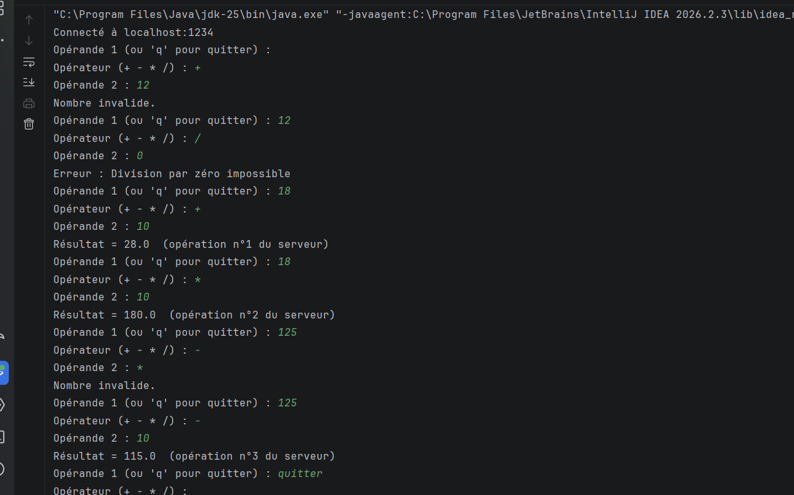
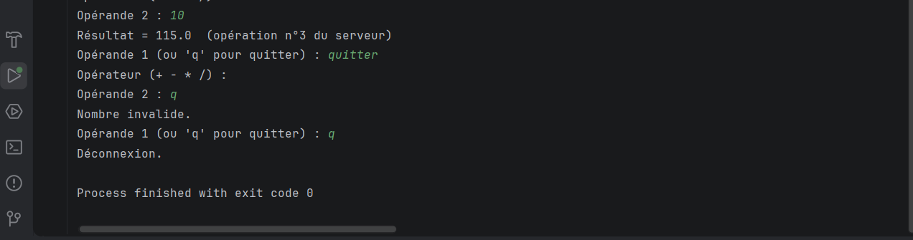
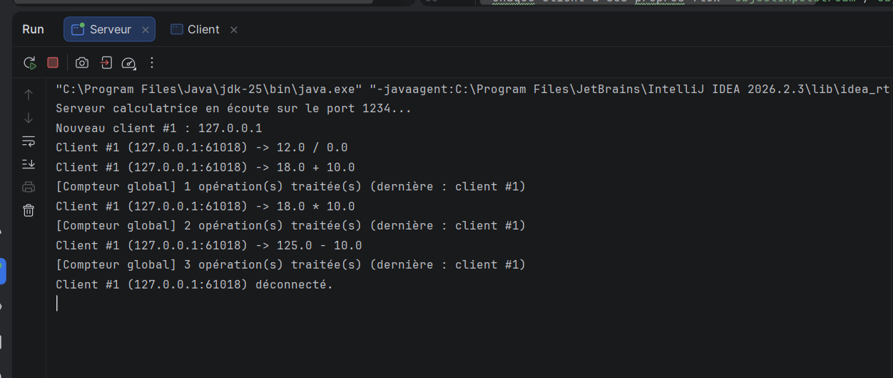
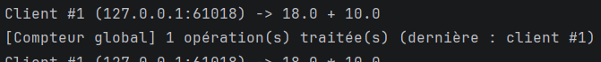

# TP3 – Activité 3-2 : Serveur multi-thread de calculatrice (TCP, objets)

**Matière** : Développement d'applications réparties – LSI 3 – FSS

**Auteur** : Maymana Amara

## Description
Serveur TCP multi-thread : un thread `ClientProcess` dédié par client. Les échanges se font par
**objets sérialisés** (`Operation` ->serveur, `Reponse` ->client). Un **compteur global**
(`CompteurGlobal`) partagé entre les threads est protégé par `synchronized` ; il est incrémenté à
chaque opération calculée et sa valeur est affichée dans la console du serveur.

## Structure
| Fichier | Rôle |
|---|---|
| `Operation.java` | Requête sérialisable (opérande1, opérateur, opérande2) |
| `Reponse.java` | Réponse sérialisable (résultat / erreur / n° d'opération) |
| `CompteurGlobal.java` | Compteur partagé, accès synchronisé |
| `ClientProcess.java` | Thread de traitement d'un client |
| `Serveur.java` | Accepte les connexions et lance un thread par client |
| `Client.java` | Client console |

## Compilation et exécution
```bash
javac *.java
java Serveur 1234                  # terminal 1
java Client localhost 1234         # terminaux 2, 3, ... (plusieurs clients)
java Client <IP_DU_SERVEUR> 1234   # depuis une autre machine du réseau local
```
Pour quitter côté client : saisir `q`.

## Tests (captures d'écran à insérer)
1. **Plusieurs clients en local** :  
2. **Test en réseau local (serveur + clients sur machines différentes)** : 
3. **Compteur global avec clients en parallèle** : 

## Synthèse
- Le serveur reste disponible : `accept()` est dans une boucle, le traitement est délégué au thread.
- Chaque client a ses propres flux `ObjectInputStream`/`ObjectOutputStream` : communications indépendantes.
- Le compteur global est une ressource critique : sans synchronisation, deux threads pourraient lire la même
  valeur et perdre une incrémentation. La méthode `static synchronized` garantit l'exclusion mutuelle ; les
  valeurs affichées sont consécutives (1, 2, 3, …) quel que soit le nombre de clients.
- Pour le test en réseau : utiliser l'adresse IP du serveur (`ipconfig` / `ip a`) et autoriser le port dans le pare-feu.